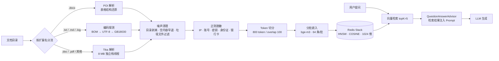

# docbase

把一堆杂乱的办公文档变成一个能问答的本地知识库。全程离线，不调用任何外部 API。

**English abstract** — docbase is a local-first RAG service that ingests messy Office documents
(`.docx` / `.doc` / `.pdf` / `.xlsx` / `.txt` / `.log`) into a Redis vector index and answers questions
against them. It runs entirely on your machine with Ollama for both embedding and generation.
The interesting part is not the chat loop — it is the ingestion pipeline: structure-preserving table
extraction, encoding fallback, TOC stripping, content-addressed idempotency, and a capacity model
derived from measurement rather than guesswork.

---

## 核心数字（都是实测，不是估算）

| 指标 | 值 |
|---|---|
| 语料规模 | **227 个文档 → 4,497 个 chunk** |
| 全量摄入耗时 | **16 分钟**（956 秒，单机单实例） |
| Redis 占用 | **162 MB** |
| 单 chunk 真实成本 | **36.9 KB**（含 HNSW 索引） |
| 单 chunk 嵌入耗时 | **0.18 ~ 0.3 秒** |
| 每 1 万 chunk | ≈ 360 MB |
| 单 chunk token 数 | **平均 532 / 最大 604**（jtokkit 实测，切分上限 600 生效） |

> **为什么是 36.9 KB 而不是 26.3 KB**：单条 chunk 的 JSON 键用 `MEMORY USAGE` 量出来是 26,298 字节，
> 但 `used_memory ÷ 条数` 是 36.9 KB。差的约 10.3 KB/chunk 是 HNSW 索引和分配开销。
> **估容量必须用后者，拿单键大小当结论会系统性低估 40%** —— 这个错误我第一次就犯了。

---

## 架构



---

## 快速开始

### 依赖

| 组件 | 版本 | 说明 |
|---|---|---|
| JDK | 21+ | |
| Redis Stack | 7.4+ | 需要 RediSearch，**普通 Redis 不行** |
| Ollama | 最新 | 提供 embedding 与 chat |

### 三步跑起来

```bash
# 1. Redis Stack
docker run -d --name redis-stack -p 6379:6379 redis/redis-stack-server:latest

# 2. 模型（bge-m3 是嵌入，qwen2.5:3b 是问答）
ollama pull bge-m3
ollama pull qwen2.5:3b

# 3. 构建并启动
./mvnw package
java -jar target/docbase-1.0.0.jar
```

默认连 `localhost:6379` 和 `localhost:11434`，向量索引会在启动时自动创建。

> 显存不足 4 GB 时，官方模型的默认参数会 OOM 或速度骤降。参见 [ollama/](ollama/)，
> 那里有实测调优过的 Modelfile（`num_gpu` 逐档实测数据），`ollama create` 一下就能用。

### 摄入与提问

```bash
# 摄入整个目录（递归，幂等，重复执行不会产生重复 chunk）
curl -X POST 'http://localhost:8800/api/ingest/dir' --data-urlencode 'path=/path/to/docs'

# 提问
curl 'http://localhost:8800/api/ask?question=报销流程有哪些审批节点'
```

---

## 接口

| 方法 | 路径 | 参数 | 说明 |
|---|---|---|---|
| POST | `/api/ingest/file` | `path`、`mode=skip\|overwrite` | 摄入单个文件，`overwrite` 强制重摄 |
| POST | `/api/ingest/dir` | `path` | 递归摄入目录，已完成的自动跳过 |
| GET | `/api/ask` | `question` | RAG 问答（检索 + 生成） |
| GET | `/api/chat` | `message` | 纯对话，不检索知识库 |
| GET | `/api/maintenance/check` | `duplicates` | 体检：孤儿 / 残缺 / 重复 |
| POST | `/api/maintenance/fix` | `limit` | 修复残缺（删掉重摄） |
| GET | `/api/maintenance/top` | `n` | chunk 数最多的文件（找病态文件用） |

---

## 配置

所有连接信息都可以用环境变量覆盖，默认值指向本机：

| 变量 | 默认值 | 说明 |
|---|---|---|
| `REDIS_HOST` / `REDIS_PORT` | `localhost` / `6379` | Redis Stack 地址 |
| `OLLAMA_BASE_URL` | `http://localhost:11434` | Ollama 地址 |
| `CHAT_MODEL` | `qwen2.5:3b` | 问答模型 |
| `TEMPERATURE` | `0.1` | 问答温度。别调回 0.7，实测精确问答会从 3/3 掉到 1/3 |
| `NUM_CTX` | `4096` | 上下文窗口，必须与 `rag.chat.top-k` 匹配 |
| `EMBEDDING_MODEL` | `bge-m3` | 嵌入模型，换它必须同步改 `dimensions` 并重建索引 |
| `SANITIZE_MODEL` | `llama3.2:3b` | 语义脱敏模型（该功能默认关闭） |
| `LOG_HOME` | `./logs` | 日志目录 |

主要业务参数：

| 配置项 | 默认 | 说明 |
|---|---|---|
| `rag.chat.top-k` | `5` | 检索片段数。受 `num-ctx` 硬约束，且不是越大越好（见文末已知限制） |
| `rag.chat.similarity-threshold` | `0` | 相似度阈值，0 = 不过滤 |
| `rag.ingest.embed-batch-size` | `64` | 单批嵌入条数，调大容易触发吞吐塌陷 |
| `rag.ingest.max-redis-memory-mb` | `1000` | Redis 内存软上限，超限停止本批（已完成的文件重跑时自动跳过） |
| `rag.ingest.progress-every` | `50` | 每多少个文件打一行进度 |
| `rag.sanitize.ai-enabled` | `false` | 语义脱敏开关，默认关（原因见文末四层实验） |
| `rag.maintenance.enabled` | `false` | 体检/修复定时任务，默认关（体检要扫全库的键） |

本地开发想改这些值，新建 `src/main/resources/application-local.yaml`（已在 `.gitignore` 中），
里面写的内容会覆盖上面的默认值，不需要每次启动传参数。

### 脱敏模型为什么是 `llama3.2:3b` 而不是 qwen

语义脱敏要做的是"把人名整体替换掉"。实测 qwen 系列会把中文姓名拆成"姓 + 名"两个 token：

```
输入  王建国和李秀兰上周去了北京出差。
qwen2.5-3b  → [PERSON]建国和[PERSON]秀兰上周去了[ADDRESS]出差。   ❌ 只替换姓
llama3.2-3b → [PERSON]和[PERSON]上周去了[ADDRESS]出差。           ✅ 整体替换
```

只替换姓属于**假脱敏**：看起来遮住了，实际仍能定位到人，比不替换更危险。所以脱敏单独用 llama3.2。

代价是慢一些（19 vs 30 tok/s），但脱敏对准确性要求高于速度，这个取舍是划算的。

> ⚠️ **如果打算开启语义脱敏（`rag.sanitize.ai-enabled=true`），先执行 `ollama pull llama3.2:3b`**，
> 否则调用时会报模型不存在。这个功能默认关闭，不开启就完全不需要这个模型。

---

## 模型文件

`ollama/` 目录下有两个 Modelfile，是在 3 GB 显存上调优过的参数版本：

| 文件 | 创建的模型 | 用途 |
|---|---|---|
| `Modelfile-qwen2.5-3b-lowvram` | `qwen2.5-3b-lowvram` | 问答，`num_gpu 36` |
| `Modelfile-llama3.2-3b-sanitize` | `llama3.2-3b-sanitize` | 语义脱敏，`num_gpu 28` + `temperature 0` |

**不是必需的**——默认配置用官方标签就能跑。只有在显存吃紧时才需要它们：

```bash
ollama pull qwen2.5:3b
ollama create qwen2.5-3b-lowvram -f ollama/Modelfile-qwen2.5-3b-lowvram
```

两个文件里都有逐档实测的 `num_gpu` → 显存占用 → tok/s 对照表，可以照着自己的显存挑。
详细说明见 [ollama/README.md](ollama/README.md)。

---

## 摄入管道做了什么

### 表格不是拍平的

Tika 处理 `.docx` 时会把表格拍成"每格一行"，切出来的 chunk 里 16.4% 是表格碎片，语义全丢。

`.docx` 改走 POI 遍历 body，表格输出成 Markdown 风格的行：

```
| 字段说明 | 字段名称 | 字段类型 | Not Null | 缺省值 |
```

细节：`gridSpan` 补空列、`vMerge=continue` 输出空串，否则合并单元格会让列错位。

> `.doc` 和 `.pdf` 的表格仍是拍平的 —— PDF 本身没有表格结构，Tika 只能按文本流输出。
> 这是已知限制，不是 bug。

### 编码兜底

GBK 编码的中文 `.txt` 被 Tika 读出 **0 个字符**，内容静默丢失。

现在纯文本走自己的解码链：`BOM 判断 → 严格 UTF-8 → GB18030 → ISO-8859-1`，每级失败才降级。

### 目录剥离

超过一半的 `.docx` 带目录页，Tika 会把目录条目当正文。目录行包含全部章节标题，是检索的"强磁铁"——
问任何问题都可能命中目录页。

清理规则：**连续 ≥3 行**匹配"编号 + 标题 + 制表符 + 页码"才整块删除。单行不删，避免误伤正常的表格行。

### 大栈线程解 StackOverflowError

老式 `.doc`（1.4 MB）在 Tika → POI/HWPF 的解析路径上，正则递归过深直接抛 `StackOverflowError`。

`StackOverflowError` 是 `Error` 分支，`catch (Exception)` 兜不住，会冒到 Spring MVC 变成 500，把整批摄入打断。

解法是把 Tika 解析放进一个 **8 MB 栈的独立线程**，而不是用 `-Xss` 调大全局栈
（那样 200 个 Tomcat 线程每个都会吃 8 MB 虚拟地址空间）。实测栈临界点：1/2/3 MB 爆，4 MB 通过，8 MB 稳定。

### 垃圾文件与 Zip bomb

- 过滤 `~$` 临时文件、`bcmap`/`rpm`/`pfx`/`cer`/`vsdx` 等抽不出内容的扩展名（实测这类文件 1,704 个，每个只能抽出 0~1 字符）
- 解析结果 < 20 字符直接标记"跳过"，与"失败"分开计数
- POI 遇到内嵌 EMF 图片的 docx 会按压缩比误判 Zip bomb 抛异常 → 任何 `Throwable` 都退回 Tika 重试

---

## 幂等：chunk id 自带指纹

不维护任何"已摄入文件"的额外状态，文件标识直接编进 chunk id：

```
doc:<SHA-256(绝对路径) 前 32 位>#<chunk 序号>
```

metadata 分两级：`source`（文件名）每个 chunk 都存；`path` / `mtime` / `chunk_count` 只存在 `#0` 上。

| 场景 | 动作 | Redis 往返 |
|---|---|:--:|
| 新文件 | `JSON.GET #0`（无）→ 解析切分 → 写入 | 2 |
| 已摄入未改动 | `JSON.GET #0` → `EXISTS #(N-1)` → 跳过 | 2 |
| 已改动 / 残缺 / 强制覆盖 | `JSON.GET #0` → 解析切分 → `DEL 0~N-1` → 写入 | 3 |

几个踩过的坑：

- **删除必须放在解析、切分、脱敏都成功之后**。放最前面的话，"旧数据删了、新数据解析失败"就把好数据搞丢了
- **完整性校验只查最后一个 chunk**。写入是顺序管道，崩了只会砍尾巴，不会中间挖洞
- **批量判断存在性不能用 `EXISTS k1 k2 ...`**。Redis 的 EXISTS 支持多键但只返回一个总数，分不出哪个不存在。
  改用管道批量 `EXISTS`，且要注意 `executePipelined` 里返回的是 `Boolean` 不是 `Long`
- 文件改名/移动会产生孤儿 chunk（路径变了 → 哈希变了 → 旧 chunk 删不掉），由体检接口报告

配套的 `/api/maintenance/*` 可以查出孤儿（磁盘已无）、残缺（最后 chunk 缺失）、重复（内容相同）三类问题。

---

## 项目结构

```
├── ollama/                                  实测调优的 Modelfile（显存 < 4GB 时用）
├── src/main/java/com/zhu/docbase/
│   ├── DocbaseApplication.java
│   ├── controller/RagController.java        7 个 HTTP 接口
│   ├── job/RagMaintenanceJob.java           定时体检/修复（默认关闭）
│   └── service/
│       ├── DocumentTextExtractor.java       按类型分流解析 + 目录清理 + 编码探测
│       ├── DocumentIngestionService.java    摄入编排：幂等、分批嵌入、内存上限
│       ├── SanitizeService.java             正则脱敏（+ 可选的语义脱敏）
│       ├── RagChatService.java              检索增强问答
│       └── RagMaintenanceService.java       孤儿 / 残缺 / 重复检测与修复
└── src/test/java/com/zhu/docbase/service/
    └── SanitizeServiceTest.java             10 个脱敏规则用例（不依赖 Redis / Ollama）
```

---

## 已知限制

- **泛问能力弱**。"X 是怎么做的"这类开放问题容易答不上，具体问题答得好。
  原因是 `topK=5` + 3B 模型的组合限制——数据是够的（全库有 893 个 chunk 含目标关键词），
  是检索宽度和模型能力的矛盾。
  **调大 topK 试过了，不行**：实测 `topK=8` 泛问确实变好，但精确问答从 3/3 答对掉到 0/3——
  3B 模型在 8 个片段里会丢针。真正的解法是 rerank（宽召回 + 重排回 5），
  但那要多一个 reranker 模型，3 GB 显存放不下
- **`.doc` / `.pdf` 表格仍是拍平的**，只有 `.docx` 做了结构还原
- **幂等是单机单实例**，不是分布式
- **文件改名会产生孤儿 chunk**，靠体检接口发现，需要手工清理
- **Redis 只开 RDB 未开 AOF**，进程崩溃最多丢最近约 1 万个写入（重跑会自动补齐）

---

## 附：三个被数据否决的方案

功能列表谁都能写，**判断一个方案该不该上，靠的是测量，不是直觉**。下面三个都是先想上、测完砍掉的。

### 1. 语义脱敏（用小模型再洗一遍文本）—— 否决

想法很自然：正则只能覆盖结构化信息，人名、机构名这类靠正则抓不全，那就让 LLM 再过一遍。

四层实验全部做完，四层全否：

| 层 | 测什么 | 结果 |
|:--:|---|---|
| 1 | 单 chunk 耗时 | **17~34 秒/chunk**（生成速度 32.5 tok/s，是 3 GB 显存的硬件上限） |
| 2 | 并发能不能救 | **不能**。并发请求排队，总吞吐不变 |
| 3 | 缩短输出能不能加速 | **反而慢 2.7 倍**（让模型少说话，它反而生成更多思考过程） |
| 4 | 质量够不够 | **人名召回只有 20%**（5 个名字只换掉 1 个），还会把正常业务字段名误替换成 `[PERSON]` |

按 6.5 万个 chunk 算，需要 13~26 天。**结论：正则脱敏足够覆盖 IP / 账号 / 密钥这类结构化信息，语义脱敏不划算。**

代码里保留了完整实现，配置项 `rag.sanitize.ai-enabled` 默认 `false`，需要时可以对少量叙述性文档单独开启。

### 2. 容量模型 —— 第一次估错了 40%

最初用 `MEMORY USAGE` 采样求平均，得出"单 chunk 26.5 KB"，据此推算能装 4~5 万个 chunk。

跑完 4,497 条真实数据后核对：`used_memory` 162.1 MB ÷ 4,497 = **36.9 KB**，而所有键的 `MEMORY USAGE` 合计只有 112.8 MB。

差的 49.3 MB 全是 HNSW 索引 + 分配开销，**这部分不会出现在单键统计里**。

### 3. 一次性提交整批嵌入 —— 吞吐塌陷

某个文件切出 686 个 chunk，一次性交给 embedding 模型，**17 分钟没有返回**，日志全无，看起来像卡死。

改成每 64 条一批后，稳定在 0.18~0.3 秒/chunk，且每批都有进度可观测。

> 顺便排除了一个看似合理的方案：给单文件加 chunk 数上限（比如 300）。实测会让文件不完整
> （686 个只留 300，丢掉 56%），属于用数据完整性换性能，不能接受。现在靠分批解决，不靠截断。

---

## License

[Apache-2.0](LICENSE)
