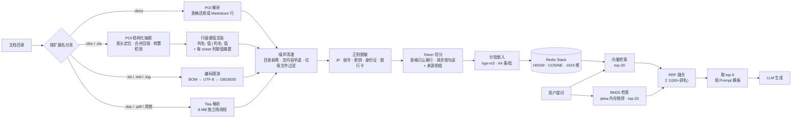

# docbase

把一堆杂乱的办公文档变成一个能问答的本地知识库。全程离线，不调用任何外部 API。

**English abstract** — docbase is a local-first RAG service that ingests messy Office documents
(`.docx` / `.doc` / `.pdf` / `.xlsx` / `.txt` / `.log`) into a Redis vector index and answers questions
against them. It runs entirely on your machine with Ollama for both embedding and generation.
Retrieval is hybrid: vector search plus an in-process BM25 index (jieba tokenizer), fused with
Reciprocal Rank Fusion — every design choice here was measured against a 30-question evaluation set,
and the ones that failed are documented at the bottom.
The interesting part is not the chat loop — it is the ingestion pipeline: structure-preserving table
extraction, encoding fallback, TOC stripping, content-addressed idempotency, and a capacity model
derived from measurement rather than guesswork.

---

## 核心数字（都是实测，不是估算）

| 指标 | 值 |
|---|---|
| 语料规模 | **229 个文档 → 7,524 个 chunk** |
| Redis 占用 | **281 MB**（含 HNSW 索引） |
| 单 chunk 真实成本 | **38.2 KB**（`used_memory ÷ 条数`） |
| 单 chunk 嵌入耗时 | **0.18 ~ 0.3 秒**（64 条一批） |
| 每 1 万 chunk | ≈ 375 MB |
| 检索命中（104 题，答案所在片段进 top-5） | **95/104**（精确 60/64 · 泛问 35/40） |
| 端到端答案覆盖（104 题） | **69.5%**（精确 75.7% · 泛问 59.7%） |
| 端到端答案覆盖（**严格口径**：只算 ≥4 字 gold） | **67.2%**（89 题） |
| BM25 索引 | 7,496 条，启动时全量构建，单次查询 **<10 ms** |
| 全量摄入耗时 | **16 分钟**（4,497 块时的实测，单机单实例） |

> **为什么是 38.3 KB 而不是 26.3 KB**：单条 chunk 的 JSON 键用 `MEMORY USAGE` 量出来是 26,298 字节，
> 但 `used_memory ÷ 条数` 是 38.2 KB。差的十几 KB 是 HNSW 索引和分配开销。
> **估容量必须用后者，拿单键大小当结论会系统性低估 40%** —— 这个错误我第一次就犯了。

---

## 架构



---

## 快速开始

### 依赖

| 组件 | 版本 | 说明 |
|---|---|---|
| JDK | 21+ | |
| Redis Stack | 7.4+ | 需要 RediSearch，**普通 Redis 不行** |
| Ollama | 最新 | 提供 embedding 与 chat |

### 三步跑起来

```bash
# 1. Redis Stack
docker run -d --name redis-stack -p 6379:6379 redis/redis-stack-server:latest

# 2. 模型（bge-m3 是嵌入，qwen2.5:3b 是问答）
ollama pull bge-m3
ollama pull qwen2.5:3b

# 3. 构建并启动
./mvnw package
java -jar target/docbase-1.0.0.jar
```

默认连 `localhost:6379` 和 `localhost:11434`，向量索引会在启动时自动创建。

> 显存不足 4 GB 时，官方模型的默认参数会 OOM 或速度骤降。参见 [ollama/](ollama/)，
> 那里有实测调优过的 Modelfile（`num_gpu` 逐档实测数据），`ollama create` 一下就能用。

### 摄入与提问

```bash
# 摄入整个目录（递归，幂等，重复执行不会产生重复 chunk）
curl -X POST 'http://localhost:8800/api/ingest/dir' --data-urlencode 'path=/path/to/docs'

# 提问
curl 'http://localhost:8800/api/ask?question=报销流程有哪些审批节点'
```

---

## 接口

| 方法 | 路径 | 参数 | 说明 |
|---|---|---|---|
| POST | `/api/ingest/file` | `path`、`mode=skip\|overwrite` | 摄入单个文件，`overwrite` 强制重摄 |
| POST | `/api/ingest/dir` | `path` | 递归摄入目录，已完成的自动跳过 |
| GET | `/api/ask` | `question` | RAG 问答（混合检索 + 生成） |
| GET | `/api/chat` | `message` | 纯对话，不检索知识库 |
| GET | `/api/retrieve` | `question`、`topK`、`vectorOnly` | 检索诊断：只检索不生成，看候选原文；`vectorOnly=true` 对比纯向量 |
| GET | `/api/retrieve-hybrid` | `question`、`recallK` | 并排显示向量名次 / BM25 名次 / 融合结果，排查"某题为什么没命中" |
| POST | `/api/bm25/rebuild` | — | 手动重建 BM25 索引（摄入后会自动重建，这个是兜底） |
| GET | `/api/maintenance/check` | `duplicates` | 体检：孤儿 / 残缺 / 重复 |
| POST | `/api/maintenance/fix` | `limit` | 修复残缺（删掉重摄） |
| GET | `/api/maintenance/top` | `n` | chunk 数最多的文件（找病态文件用） |

---

## 配置

所有连接信息都可以用环境变量覆盖，默认值指向本机：

| 变量 | 默认值 | 说明 |
|---|---|---|
| `REDIS_HOST` / `REDIS_PORT` | `localhost` / `6379` | Redis Stack 地址 |
| `OLLAMA_BASE_URL` | `http://localhost:11434` | Ollama 地址 |
| `CHAT_MODEL` | `qwen2.5:3b` | 问答模型 |
| `TEMPERATURE` | `0.1` | 问答温度。别调回 0.7，实测精确问答会从 3/3 掉到 1/3 |
| `NUM_CTX` | `4096` | 上下文窗口，必须与 `rag.chat.top-k` 匹配 |
| `TOP_K` | `5` | 最终喂给模型的片段数 |
| `RECALL_K` | `20` | 每路召回的候选数 |
| `RRF_K` | `60` | RRF 的平滑常数 |
| `BM25_ENABLED` | `true` | 关键词这一路的开关，关掉退化为纯向量 |
| `EMBEDDING_MODEL` | `bge-m3` | 嵌入模型，换它必须同步改 `dimensions` 并重建索引 |
| `SANITIZE_MODEL` | `llama3.2:3b` | 语义脱敏模型（该功能默认关闭） |
| `MAX_FILE_SIZE_MB` | `10` | 单文件体积上限（MB），超过就跳过 |
| `LOG_HOME` | `./logs` | 日志目录 |

主要业务参数：

| 配置项 | 默认 | 说明 |
|---|---|---|
| `rag.chat.top-k` | `5` | 最终喂给模型的片段数。受 `num-ctx` 硬约束，且不是越大越好（见文末已知限制） |
| `rag.chat.recall-k` | `20` | 每路召回的候选数（融合的输入，不直接进提示词） |
| `rag.chat.rrf-k` | `60` | RRF 的 k。越小头部权重越大，60 是原论文经验值 |
| `rag.chat.bm25.enabled` | `true` | 关键词这一路的开关，关掉退化为纯向量 |
| `rag.chat.bm25.rebuild-quiet-ms` | `3000` | 摄入事件后等多久安静再重建索引（合并连续摄入） |
| `rag.chat.prompt-file` | `prompts/qa.txt` | 问答提示词模板（classpath） |
| `rag.ingest.max-file-size-mb` | `10` | 单个文件的体积上限（MB），超过就跳过。要摄扫描件 PDF / 整本手册时调大；别一次调很大，Tika 解析大文件吃堆内存 |
| `rag.ingest.embed-batch-size` | `64` | 单批嵌入条数，调大容易触发吞吐塌陷 |
| `rag.ingest.max-redis-memory-mb` | `1000` | Redis 内存软上限，超限停止本批（已完成的文件重跑时自动跳过） |
| `rag.ingest.progress-every` | `50` | 每多少个文件打一行进度 |
| `rag.sanitize.ai-enabled` | `false` | 语义脱敏开关，默认关（原因见文末四层实验） |
| `rag.maintenance.enabled` | `false` | 体检/修复定时任务，默认关（体检要扫全库的键） |

本地开发想改这些值，新建 `src/main/resources/application-local.yaml`（已在 `.gitignore` 中），
里面写的内容会覆盖上面的默认值，不需要每次启动传参数。

### 脱敏模型为什么是 `llama3.2:3b` 而不是 qwen

语义脱敏要做的是"把人名整体替换掉"。实测 qwen 系列会把中文姓名拆成"姓 + 名"两个 token：

```
输入  王建国和李秀兰上周去了北京出差。
qwen2.5-3b  → [PERSON]建国和[PERSON]秀兰上周去了[ADDRESS]出差。   ❌ 只替换姓
llama3.2-3b → [PERSON]和[PERSON]上周去了[ADDRESS]出差。           ✅ 整体替换
```

只替换姓属于**假脱敏**：看起来遮住了，实际仍能定位到人，比不替换更危险。所以脱敏单独用 llama3.2。

代价是慢一些（19 vs 30 tok/s），但脱敏对准确性要求高于速度，这个取舍是划算的。

> ⚠️ **如果打算开启语义脱敏（`rag.sanitize.ai-enabled=true`），先执行 `ollama pull llama3.2:3b`**，
> 否则调用时会报模型不存在。这个功能默认关闭，不开启就完全不需要这个模型。

---

## 模型文件

`ollama/` 目录下有两个 Modelfile，是在 3 GB 显存上调优过的参数版本：

| 文件 | 创建的模型 | 用途 |
|---|---|---|
| `Modelfile-qwen2.5-3b-lowvram` | `qwen2.5-3b-lowvram` | 问答，`num_gpu 36` |
| `Modelfile-llama3.2-3b-sanitize` | `llama3.2-3b-sanitize` | 语义脱敏，`num_gpu 28` + `temperature 0` |

**不是必需的**——默认配置用官方标签就能跑。只有在显存吃紧时才需要它们：

```bash
ollama pull qwen2.5:3b
ollama create qwen2.5-3b-lowvram -f ollama/Modelfile-qwen2.5-3b-lowvram
```

两个文件里都有逐档实测的 `num_gpu` → 显存占用 → tok/s 对照表，可以照着自己的显存挑。
详细说明见 [ollama/README.md](ollama/README.md)。

---

## 摄入管道做了什么

### 表格不是拍平的

Tika 处理 `.docx` 时会把表格拍成"每格一行"，切出来的 chunk 里 16.4% 是表格碎片，语义全丢。

`.docx` 改走 POI 遍历 body，表格输出成 Markdown 风格的行：

```
| 字段说明 | 字段名称 | 字段类型 | Not Null | 缺省值 |
```

细节：`gridSpan` 补空列、`vMerge=continue` 输出空串，否则合并单元格会让列错位。

> `.doc` 和 `.pdf` 的表格仍是拍平的 —— PDF 本身没有表格结构，Tika 只能按文本流输出。
> 这是已知限制，不是 bug。

### `.xlsx`：从"单元格墙"到"一条记录一行"

表格类文件占全库 chunk 的一半以上，所以这一块单独做了三层处理。

**第一层，结构化抽取。** 实测 39 个 sheet 里：**19/31 个文件的表头不在第 1 行**（有的在第 8 行）、
**35/39 个 sheet 有合并单元格**（合计 1,569 格只有左上角有值）、多级表头回填后会出现多个同名列。
合并单元格不回填**是数据错误，不是效果问题** —— 纵向合并的分类字段在下面各行直接变空串。

**第二层，渲染格式。** 四种候选做过 43 题对照（每臂跑 3 次，同题配对 t 检验）：

| 格式 | 答案覆盖 |
|---|:--:|
| A 单元格墙 | 45% |
| A2 单元格墙 + 表头行 | 44% |
| **B 行级键值（采用）** | **60%** |
| C Markdown 表格 | 52% |

A2 与 B 差 **16.6pp，t = −2.5**，显著。行级键值就是一条记录一行、字段用 `|` 分隔：

```
列名: 值 | 列名: 值 | 列名: 值
```

一条记录自包含，检索命中哪一条就能直接读出"这个值属于哪个字段"，不需要回头找表头。

**第三层，列取值摘要。** 有一类问题问的是"某列有哪些取值"（有哪些类别、还有哪些类型），
答案分散在几十条记录里，而检索只取 top-5 块。所以每个 sheet 额外输出几行摘要：

```
【列取值】某表.xlsx｜sheet: Sheet1
事项（出现最多）: 甲事项×285、乙事项×252、丙事项×93…（共 267 种）
状态: 待处理、进行中、已完成、已关闭（共 4 种）
```

两种写法按列的基数自动选：**低基数列**（2~20 个取值）全量列举，**高基数列**列出现最多的前 10 个带频次
（实测某表的"事项"列有 370 种取值，全量列举写不下，而"最多的几件事"正是要答的）。
挡噪音六道闸：单值 >24 字不算类别值、以数字为主的列跳过、序号/编号列跳过、占位列跳过、
纯脱敏占位符列（`[IP]` 这类）只报数量、备注类列豁免"每行都不同"的检查；
每 sheet 最多 **12 列**、总字数 **1200**，单列超长折叠成「…（共 N 种）」。

实测这一层把 43 题子集从 57.6% 提到 **61.9%**；再把摘要拆成独立块（不跟表头挤在一起）
又到 **65.6%** —— 差别不在摘要内容，在它能不能被召回。
2026-10-26 把列上限从 6 提到 12、给备注列开豁免，**再到 72.4%**：
起因是一张 12 列的表只摘到第 6 列，靠后的「备注」列被两个 IP 列挤掉，
而那道题的答案全在备注列里。

**切点：表格只认换行。** 切块器默认在 `.` `?` `!` `\n` 里取**位置最靠后**的那个字符处切断。
表格正文里全是 IP、金额、日期、版本号，最后一个 `.` 常落在数字中间 —— 于是一条记录被腰斩，
续块开头只剩半条记录、键名丢失。实测 3,591 个表格块里 **1,724 块（48%）** 首行不是完整记录。

改成表格只把换行当切点后：断头降到 **46/4,334（1.1%）**，代价是块数 +20%
（记录必须整条进块，块装不满）。**注意：这个改动让块更完整，但端到端覆盖率基本没动**
（43 题 −0.6pp）—— 说明覆盖率卡住的不是"块缺一块"，而是检索排序和生成。

### 编码兜底

GBK 编码的中文 `.txt` 被 Tika 读出 **0 个字符**，内容静默丢失。

现在纯文本走自己的解码链：`BOM 判断 → 严格 UTF-8 → GB18030 → ISO-8859-1`，每级失败才降级。

### 目录剥离

超过一半的 `.docx` 带目录页，Tika 会把目录条目当正文。目录行包含全部章节标题，是检索的"强磁铁"——
问任何问题都可能命中目录页。

清理规则：**连续 ≥3 行**匹配"编号 + 标题 + 制表符 + 页码"才整块删除。单行不删，避免误伤正常的表格行。

### 大栈线程解 StackOverflowError

老式 `.doc`（1.4 MB）在 Tika → POI/HWPF 的解析路径上，正则递归过深直接抛 `StackOverflowError`。

`StackOverflowError` 是 `Error` 分支，`catch (Exception)` 兜不住，会冒到 Spring MVC 变成 500，把整批摄入打断。

解法是把 Tika 解析放进一个 **8 MB 栈的独立线程**，而不是用 `-Xss` 调大全局栈
（那样 200 个 Tomcat 线程每个都会吃 8 MB 虚拟地址空间）。实测栈临界点：1/2/3 MB 爆，4 MB 通过，8 MB 稳定。

### 垃圾文件与 Zip bomb

- 过滤 `~$` 临时文件、`bcmap`/`rpm`/`pfx`/`cer`/`vsdx` 等抽不出内容的扩展名（实测这类文件 1,704 个，每个只能抽出 0~1 字符）
- 解析结果 < 20 字符直接标记"跳过"，与"失败"分开计数
- POI 遇到内嵌 EMF 图片的 docx 会按压缩比误判 Zip bomb 抛异常 → 任何 `Throwable` 都退回 Tika 重试

---

## 幂等：chunk id 自带指纹

不维护任何"已摄入文件"的额外状态，文件标识直接编进 chunk id：

```
doc:<SHA-256(绝对路径) 前 32 位>#<chunk 序号>
```

metadata 分两级：`source`（文件名）每个 chunk 都存；`path` / `mtime` / `chunk_count` 只存在 `#0` 上。

| 场景 | 动作 | Redis 往返 |
|---|---|:--:|
| 新文件 | `JSON.GET #0`（无）→ 解析切分 → 写入 | 2 |
| 已摄入未改动 | `JSON.GET #0` → `EXISTS #(N-1)` → 跳过 | 2 |
| 已改动 / 残缺 / 强制覆盖 | `JSON.GET #0` → 解析切分 → `DEL 0~N-1` → 写入 | 3 |

几个踩过的坑：

- **删除必须放在解析、切分、脱敏都成功之后**。放最前面的话，"旧数据删了、新数据解析失败"就把好数据搞丢了
- **完整性校验只查最后一个 chunk**。写入是顺序管道，崩了只会砍尾巴，不会中间挖洞
- **批量判断存在性不能用 `EXISTS k1 k2 ...`**。Redis 的 EXISTS 支持多键但只返回一个总数，分不出哪个不存在。
  改用管道批量 `EXISTS`，且要注意 `executePipelined` 里返回的是 `Boolean` 不是 `Long`
- 文件改名/移动会产生孤儿 chunk（路径变了 → 哈希变了 → 旧 chunk 删不掉），由体检接口报告

配套的 `/api/maintenance/*` 可以查出孤儿（磁盘已无）、残缺（最后 chunk 缺失）、重复（内容相同）三类问题。

---

## 混合检索：向量 + BM25，用 RRF 融合

### 为什么要两路

同一批问题里，两类失败模式是互补的：

- 有些题的正确答案被向量排到 12~17 名（`topK=5` 根本看不到），而关键词能排到第 1
- 反过来也有题向量命中、关键词排到 60 名之外

所以两路各召回 20 条，融合后**仍然只喂 5 条**——候选池变宽，提示词长度不变。

### 为什么不用 Redis 自带的全文检索

`$.content` 本来就是 TEXT 字段，建索引时加 `LANGUAGE chinese` 就能中文检索，看起来零成本。
实测只有 **19/30** 命中 top-5，比纯向量（20/30）还差——Friso 对中文复合词的切分质量明显不如 jieba。

所以用 jieba-analysis 在 JVM 里建内存倒排：7,496 条约 **10 MB** 内存，查询 **<10 ms**
（构建是启动时全量扫一遍，4,497 条时实测 3.4 秒）。

### RRF 是什么

```
score(d) = Σ_i  1 / (k + rank_i(d))        k = 60
```

只使用**排名**，不使用分数：向量是 cosine（0~1，集中在 0.5~0.8），BM25 是无上界分值，
两者尺度不可比；排名天然可比，不需要归一化假设。

它奖励"两路都还行"，惩罚"一路极好、另一路没有"：向量第 1 名 + BM25 第 26 名（超出 top-20 不计分）
只得 1/61≈0.0164，会被"向量第 5 + BM25 第 3"（1/65+1/63≈0.0313）压过。
**实测有 3 道题因此变差，这是融合的固有特性，不是 bug。**

### 实测（30 题评测集，答案所在片段是否进 top-5）

| 方案 | 精确 | 泛问 | 合计 | 单次查询增量耗时 |
|---|:--:|:--:|:--:|:--:|
| 纯向量 | 6/15 | 14/15 | **20/30** | 0 |
| 纯 BM25 | 11/15 | 14/15 | **25/30** | ~10 ms |
| **RRF 融合** | 11/15 | 15/15 | **26/30** | ~10 ms |
| cross-encoder 重排 | 13/15 | 13/15 | 26/30 | **35 秒** |
| RRF + 重排 | 11/15 | 14/15 | 25/30 | **35 秒** |

端到端答案覆盖率：泛问 38% → **49%**，精确 41% → 38%（检索更准了，但部分答案没有原样命中
关键字符串；纯向量三次实测分别是 28%/41%/38%，本身波动较大）。

> 上表是 30 题版本（选型当时用的题集），保留原样以便对照。
> **当前 104 题（64 精确 + 40 泛问）的实测**：gold 进 top-5 **95/104**，端到端答案覆盖 **69.5%**
> （精确 75.7% / 泛问 59.7%）；换成**严格口径**（只算 ≥4 字的 gold，89 题）是 **67.2%**。两次测量之间还做过表格渲染、切点、列取值摘要、提示词和摘要块扩列五轮改动，不能直接相减。
> 104 题里后 46 道是 2026-10-26 补的：前 28 道偏简单（78.6%），后 18 道按难度筛（58.3%）——
> **看趋势用前 58 题子集**（58.6%），它跨了全部历史阶段。

### 索引刷新

摄入完成后自动重建（走 `IngestCompletedEvent` 事件）：

- **目录摄入**期间不发事件，整批结束发一次（否则 200 多个文件会触发 200 多次重建）
- **单文件摄入**每次发一次，但有 3 秒安静期防抖，连续的多次摄入会合并成一轮

重建在独立线程，`index` 是 volatile 整体替换——查询读到的是旧快照，不阻塞、也不会读到半成品。

---

## 项目结构

```
├── ollama/                                  实测调优的 Modelfile（显存 < 4GB 时用）
├── src/main/java/com/zhu/docbase/
│   ├── DocbaseApplication.java
│   ├── controller/RagController.java        10 个 HTTP 接口
│   ├── event/IngestCompletedEvent.java      摄入完成事件（触发索引刷新）
│   ├── job/RagMaintenanceJob.java           定时体检/修复（默认关闭）
│   └── service/
│       ├── DocumentTextExtractor.java       按类型分流解析 + 目录清理 + 编码探测
│       ├── XlsxTextExtractor.java           表格结构化抽取 + 行级键值渲染 + 列取值摘要
│       ├── DocumentIngestionService.java    摄入编排：幂等、分批嵌入、内存上限
│       ├── SanitizeService.java             正则脱敏（+ 可选的语义脱敏）
│       ├── Bm25IndexService.java            内存倒排 + BM25 打分（jieba 分词）
│       ├── HybridRetriever.java             向量 + BM25 → RRF → top-5
│       ├── RagChatService.java              填模板 + 调用模型
│       └── RagMaintenanceService.java       孤儿 / 残缺 / 重复检测与修复
└── src/test/java/com/zhu/docbase/service/
    └── SanitizeServiceTest.java             10 个脱敏规则用例（不依赖 Redis / Ollama）
```

---

## 怎么衡量"改得好不好"

调参之前先有题集，否则每次改动都只能靠"感觉好点了"。这里的做法：

| 项 | 做法 | 为什么 |
|---|---|---|
| 题集 | **104 题**（64 精确 + 40 泛问），每题标注"答案里必须出现的关键字符串" | 精确题考定位，泛问考跨段归纳，两类的最优参数是相反的 |
| 判分 | 字符串命中率，**不用 LLM 当裁判** | 便宜、可复现；代价是低估语义正确的答案（见已知限制） |
| **关键列** | 除了答案覆盖率，还记 **gold 是否在 top-5 / top-20 候选里** | 这一列把"召回失败"和"生成失败"分开。没有它，会把"老实说不知道"当退步、把"编造命中"当进步 |
| 可复现 | `temperature=0` + 固定 `seed` | **只固定温度不够**：不指定 seed 时推理引擎每次自选种子，同一 prompt 三次三种答案。另外模型重载后第一次调用可能不同，测量前先空跑一次预热 |
| 口径 | 每个数字都标清楚"哪一轮、什么口径" | 同一个指标在不同阶段有多个值（块数 4,497 / 4,544 / 6,757 / 7,482 / 7,496），混用会得出相反结论 |

> 一个具体教训：某次 P14 从 57% 掉成 0%，看着像"检索崩了"，实际是判分大小写敏感 ——
> gold 写的是小写 `rocketmq`，模型答的是 `RocketMQ`。**先怀疑度量，再怀疑系统。**

---

## 已知限制

- **答案覆盖率 64.0%，剩下的不是检索问题**。104 题里 gold 进 top-5 的有 94 道，
  但最终答案原样命中关键字符串的只有 64.0%。差的那部分里，有 22 道题的材料已经在上下文里、
  模型没写出来 —— 是 3B 模型跨段归纳的能力上限，不是召回问题
- **提示词里的字面模板会被照抄**。早先的提示词写着「另起一行写『未覆盖：缺少什么信息』」，
  结果 51/59 的答案末尾原样挂着这句话（正文其实答出来了）。换成行为描述后清零
- **但换措辞对分数的影响落在噪声里**。三版提示词实测 59 题覆盖 **63.0% / 60.5% / 58.8%**，
  同题配对检验 t = 0.56 / 1.35 / 0.40，**一个都不显著** —— 单次 59 题的配对标准误就是 3~6pp，
  而换一句话会让十几道题各自跳 ±25~100pp，互相抵消。**别用单次评测去选提示词措辞**；
  想看 5pp 以内的效果，得重复多个种子或加题
- **`topK` 不能靠加大来解决**。实测 `topK=8`：泛问变好，精确问答从 3/3 答对掉到 0/3；
  把 `topK` 加到 10（配 8192 上下文）在 14 道零覆盖题上只救回 3 道，还有 1 道从 57% 掉到 29%
  —— 3B 模型在更多片段里会丢针。所以走的是"宽召回 + 融合压缩"，而不是往提示词里塞更多片段
- **判分是字符串命中，会低估语义正确的答案**。同一份答案，大小写敏感和不敏感的判分能差 1~4pp
  （`RocketMQ` 与 `rocketmq` 算不算命中）。现在两边都跑，报数时标清楚口径
- **2 字 gold 会把分数抬高 2~3pp**。评测集里有一批 2~3 字的 gold（银行名、章名），沾边就命中。
  同一批题按「只算 ≥4 字 gold」重算会低 1.7~3pp。两个口径都报，别混着比
- **有两道题的答案只写在文件名里**（正文里一次都没出现），检索能靠来源前缀找到文件，
  但模型拿不到那段信息。这属于题目/语料问题，不是检索问题
- **正文抽不出来的文件，用文件名兜底入库**。有些文档正文是空的，但文件名本身就是结论
  （形如「xxx四家银行有xxx模式.doc」）。这类文件以前被「内容过短」整份跳过，库里查不到。
  现在文件名有 ≥10 个汉字时，就把文件名当正文入库 —— 垃圾文件名（bcmap / rpm / `~$` 锁文件）
  是短英文，不受影响
- **`.doc` / `.pdf` 表格仍是拍平的**，只有 `.docx` 和 `.xlsx` 做了结构还原
- **BM25 索引是全量重建**。摄入后会自动重建（单文件/目录各触发一次），
  但扩到 6.5 万 chunk 时重建要 1 分钟左右，那时需要改成增量追加或索引持久化
- **幂等是单机单实例**，不是分布式
- **文件改名会产生孤儿 chunk**，靠体检接口发现，需要手工清理
- **Redis 只开 RDB 未开 AOF**，进程崩溃最多丢最近约 1 万个写入（重跑会自动补齐）

---

## 附：八个被数据否决的方案

功能列表谁都能写，**判断一个方案该不该上，靠的是测量，不是直觉**。下面八个都是先想上、测完砍掉的（前四个展开了，后四个在最后一张表里）。

### 1. 语义脱敏（用小模型再洗一遍文本）—— 否决

想法很自然：正则只能覆盖结构化信息，人名、机构名这类靠正则抓不全，那就让 LLM 再过一遍。

四层实验全部做完，四层全否：

| 层 | 测什么 | 结果 |
|:--:|---|---|
| 1 | 单 chunk 耗时 | **17~34 秒/chunk**（生成速度 32.5 tok/s，是 3 GB 显存的硬件上限） |
| 2 | 并发能不能救 | **不能**。并发请求排队，总吞吐不变 |
| 3 | 缩短输出能不能加速 | **反而慢 2.7 倍**（让模型少说话，它反而生成更多思考过程） |
| 4 | 质量够不够 | **人名召回只有 20%**（5 个名字只换掉 1 个），还会把正常业务字段名误替换成 `[PERSON]` |

按 6.5 万个 chunk 算，需要 13~26 天。**结论：正则脱敏足够覆盖 IP / 账号 / 密钥这类结构化信息，语义脱敏不划算。**

代码里保留了完整实现，配置项 `rag.sanitize.ai-enabled` 默认 `false`，需要时可以对少量叙述性文档单独开启。

### 2. 容量模型 —— 第一次估错了 40%

最初用 `MEMORY USAGE` 采样求平均，得出"单 chunk 26.5 KB"，据此推算能装 4~5 万个 chunk。

跑完 4,497 条真实数据后核对：`used_memory` 162.1 MB ÷ 4,497 = **36.9 KB**，而所有键的 `MEMORY USAGE` 合计只有 112.8 MB。
（库扩到 7,520 块后这个数是 **38.2 KB** —— 索引变大，单块成本还会缓慢上升。）

差的 49.3 MB 全是 HNSW 索引 + 分配开销，**这部分不会出现在单键统计里**。

### 3. 一次性提交整批嵌入 —— 吞吐塌陷

某个文件切出 686 个 chunk，一次性交给 embedding 模型，**17 分钟没有返回**，日志全无，看起来像卡死。

改成每 64 条一批后，稳定在 0.18~0.3 秒/chunk，且每批都有进度可观测。

> 顺便排除了一个看似合理的方案：给单文件加 chunk 数上限（比如 300）。实测会让文件不完整
> （686 个只留 300，丢掉 56%），属于用数据完整性换性能，不能接受。现在靠分批解决，不靠截断。

### 4. cross-encoder 重排 —— 否决

想法很标准：宽召回 20 条，用 cross-encoder 逐对打分重排回 5 条。这是教科书做法，
问过的 8 个模型里有 7 个推荐它。

实测 `bge-reranker-v2-m3`（568M，CPU 8 线程，截断 512）：

| 项 | 值 |
|---|---|
| 单对耗时 | **1.6 秒** |
| 单题（20 候选） | **26~44 秒** |
| 精确题 top-5 | 6/15 → **13/15**（确实有效） |
| 泛问题 top-5 | 14/15 → 13/15（退步） |
| **叠在 RRF 上** | 26/30 → **25/30**（反而更差） |

两个原因：

1. **RRF 已经牺牲了单路长尾**。有些题向量排第 1 但关键词排第 60，融合后掉到第 11 ——
   重排只能在融合后的池子里调整，救不回来
2. **池子越干净，重排的扰动越像噪声**。有两道题本来融合后排第 2、第 4，重排后掉到第 8、第 11

单题多 35 秒，收益为负。否掉。

### 5 ~ 8. 后来又测了四个，全部否掉

| 想法 | 看起来为什么该做 | 实测 |
|---|---|---|
| **列式键值**：`列名: 值1、值2、值3`，不再每行重复列名 | 能省 2/3 的字符 | 只省 **29%** 块数（粗口径估的 67% 不成立），且丢失行内绑定；43 题 59% vs 64%，**t=1.2 不显著** |
| **记录之间加空行**：`\n` → `\n\n`，防止记录被切断 | 切块器"按换行切"，多一个空行应该更安全 | 读源码发现切点取 `.` `?` `!` `\n` 里**最靠后**的那个，两者只差 1 个字符：5 个真实文件实测**块数完全相同、逐块 0 差异**。真因是句号被当切点（已按这个改掉） |
| **`topK` 加到 10**（配 8192 上下文） | 更多候选 = 更高的召回 | 14 道零覆盖题里 **3 道变好、1 道变差（57%→29%）、10 道没动**；显存够（2.6 GB / 3 GB），是模型在更多片段里丢针 |
| **调 RRF 的 k** | 融合权重没调过，也许能救长尾 | k=10 / 60 / 120 在 13 道零覆盖题上是 **1.9% / 0% / 0%** —— 这些题缺的是内容或生成，不是排序 |

> 这一批的共同点：**都只改一个参数或一行文本，看起来零风险**。
> 但四次里有三次的预期方向是错的，所以现在定方案前先算一遍"这个改法能覆盖几道题"。

---

## License

[Apache-2.0](LICENSE)
